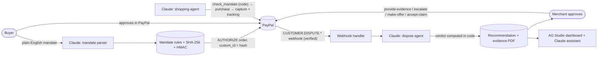

# Vouch

**AI shopping agents that can prove what the buyer asked for, and an AI dispute agent that uses that proof.**

Live demo: **https://vouch-7idi.onrender.com** (PayPal sandbox) · Built for the [PayPal AI Hackathon](https://paypalaihackathon.devpost.com) · MIT licensed

---

## The problem

AI agents are starting to shop for people. When an agent buys something and the buyer later says
*"I never wanted that"*, the merchant has no way to show what the buyer actually authorized. The
dispute becomes a coin flip. Small merchants usually refund to avoid the hassle, or lose a chargeback
they could have won.

## What Vouch does

1. **The buyer writes a mandate** in plain English, for example *"Buy me a USB-C charger, at least 45W
   if possible, no more than $30, arriving within 5 days."* Claude turns it into strict rules
   (category, spending limit, currency, expiry, delivery date).
2. **The buyer approves the mandate in PayPal.** Vouch creates a PayPal order with `intent: AUTHORIZE`
   for the spending limit. The mandate's SHA-256 fingerprint is stored as the order's `custom_id`, and
   its one-line summary appears in the buyer's own PayPal activity. PayPal's record now proves which
   rules the buyer approved.
3. **A shopping agent buys within the mandate.** A Claude agent searches the catalog, but it can only
   buy through a `purchase` tool that refuses any item the deterministic `check_mandate` code hasn't
   passed. The purchase captures from the buyer's authorization, and tracking is added to the PayPal
   order. Every step is logged as a decision trail.
4. **When the buyer disputes,** PayPal's `CUSTOMER.DISPUTE.*` webhook (signature verified) brings the
   dispute in, and the **dispute agent** starts on its own. It reads the dispute, finds the purchase
   and mandate, verifies the fingerprint against PayPal's `custom_id`, re-checks every rule, and
   reads the shopping agent's trail.
5. **The verdict is computed in code, not by the model:** `IN_MANDATE` means fight, `OUT_OF_MANDATE`
   means refund. Claude writes the explanation and the response to PayPal, and Vouch generates an
   evidence PDF.
6. **The merchant approves in one click** (human in the loop for anything that moves money). Vouch
   then acts through the PayPal Disputes API: it provides evidence, escalates an inquiry to a claim,
   makes an offer, or accepts the claim.
7. **An AG Studio dashboard** shows money at risk, recovered and refunded, the mandate-match rate, the
   win rate, deadlines, and every mandate with its signature check. It has a Claude-powered assistant
   that can answer questions about the data and edit the report.

Vouch is honest by design: when the agent broke the mandate, it recommends refunding the buyer.

### Verified end to end in the PayPal sandbox

| Case | What happened |
|---|---|
| In-mandate charger, buyer claims "not as described" | Agent: `IN_MANDATE → FIGHT` (92%). Merchant approved. Evidence PDF filed and the inquiry escalated. PayPal settled **`RESOLVED_SELLER_FAVOUR`**. |
| Misbehaving agent bought a power bank (outside the "USB-C charger" mandate) | Agent: `OUT_OF_MANDATE → ACCEPT`. Merchant approved, the claim was accepted, the buyer was refunded (**`RESOLVED_BUYER_FAVOUR`**). |
| Ordinary sale with no mandate, "item not received" | Agent: `UNKNOWN` (no mandate, no tracking) and recommends a refund, advising the merchant to check their own shipping records first. |

## Architecture



| Layer | What it uses |
|---|---|
| App | Next.js 16 (App Router), TypeScript, Tailwind, started from the PayPal + AG Studio hackathon boilerplate |
| PayPal | Orders v2 (`AUTHORIZE`, authorize, `custom_id`, tracking), Payments v2 (partial capture with `final_capture`), Disputes v1 (list/get, provide-evidence, send-message, escalate, make-offer, accept-claim, sandbox adjudicate), Webhooks (registration and signature verification), JS SDK buttons |
| AI | Claude Opus 5.5 through the Anthropic TypeScript SDK: structured outputs, the tool runner, adaptive thinking, server-side fallback |
| Data | PostgreSQL on Render (`pg`), schema in [`db/schema.sql`](db/schema.sql) |
| Dashboard | AG Studio 3 and AG Grid 36, with a custom Claude adapter for AG Studio's AI assistant |
| Hosting | Render web service ([`render.yaml`](render.yaml)) |

Key files:

```
lib/mandate.ts            canonical hashing, HMAC signing, verification, deterministic rule check
lib/mandates.ts           AUTHORIZE order with custom_id + summary item, authorization
lib/agent/shopper.ts      shopping agent (Claude tool runner; purchase gated by check_mandate)
lib/agent/dispute.ts      dispute agent (investigation tools, code-computed verdict, recommendation)
lib/submit.ts             executes the approved action against the Disputes API
lib/evidence-pdf.ts       mandate evidence record (PDF)
app/api/webhooks/paypal   verified webhook → dispute refresh → auto-investigation
app/api/ai/claude         AG Studio LLM adapter on Claude (server side)
app/dashboard             AG Studio dashboard (Vouch data sources + report)
```

## Run it locally

Requirements: Node.js 20.9+ (tested on 24 and 26), a PayPal sandbox developer account, an
Anthropic API key, and a Postgres database.

```bash
git clone https://github.com/dimitrirasc0/Vouch.git && cd Vouch
npm install
cp env.example .env          # then fill in the values (below)
npm run db:migrate           # creates the tables
npm run pp:check             # verifies PayPal credentials and dispute permissions
npm run dev                  # http://localhost:3000
```

### Environment

| Variable | Where it comes from |
|---|---|
| `PAYPAL_CLIENT_ID`, `PAYPAL_CLIENT_SECRET` | PayPal Developer Dashboard → Sandbox → Apps & Credentials. Use a Merchant app on the sandbox **business** account with *Customer disputes* enabled. |
| `NEXT_PUBLIC_PAYPAL_CLIENT_ID` | Same value as `PAYPAL_CLIENT_ID` (used by the JS SDK button) |
| `PAYPAL_WEBHOOK_ID` | Printed by `npm run pp:webhook -- https://<public-url>/api/webhooks/paypal` |
| `PAYPAL_BUYER_EMAIL` | Your sandbox **personal** (buyer) account email |
| `ANTHROPIC_API_KEY` | console.anthropic.com |
| `DATABASE_URL` | Any Postgres (we use Render Postgres) |
| `MANDATE_SIGNING_SECRET` | Any random 32-byte hex string: `node -e "console.log(require('crypto').randomBytes(32).toString('hex'))"` |
| `AG_STUDIO` | AG Studio licence key (optional locally; removes the licence warnings) |

To receive webhooks locally, expose port 3000 (for example `cloudflared tunnel --url http://localhost:3000`)
and register the tunnel URL with `npm run pp:webhook`. The **Sync from PayPal** button covers late
sandbox webhooks.

### Walk through the demo

1. **New mandate** (`/mandates/new`): keep the example text → **Create mandate** → approve with the
   PayPal button, logged in as the sandbox **buyer**.
2. **Open mandate** → **Run shopping agent**. It buys an item that passes the mandate. To see the
   other outcome, create a second mandate and tick *Demo: misbehaving agent*: a scripted, non-AI
   agent skips the check and buys a power bank.
3. As the buyer at `sandbox.paypal.com`: **Activity** → the payment → **Report a problem** → *not as
   described*.
4. The dispute arrives through the webhook (the sandbox takes about 10–15 minutes) and the dispute
   agent investigates on its own. Open it from the home page, review, and click **Approve & submit**.
5. For a fought case, PayPal offers sandbox settlement some time after the evidence is in (about 40
   minutes in our tests). Click **Simulate PayPal decision**.
6. **Dashboard** (`/dashboard`): the money recovered and refunded, rates and deadlines. Open **Edit**
   to use the Claude assistant.

### PayPal sandbox notes (learned the hard way)

- Creating disputes through the API (`POST /v1/customer/disputes`) needs a buyer-consent setup our
  app didn't have ("No permissions to set target_client_id"), so demo disputes are opened from the
  sandbox buyer website.
- "Not as described" inquiries don't offer `provide_evidence`. Vouch escalates to a claim (retrying
  briefly after a dispute message), then uploads evidence using an evidence type PayPal requests from
  the seller (`OTHER`, not `PROOF_OF_FULFILLMENT`).
- Webhooks arrive 10–15 minutes late and out of order, so the handler always re-fetches the dispute
  instead of trusting the payload.

## AI tools used

| Tool | How |
|---|---|
| **Claude Opus 5.5** (Anthropic API) | Inside the product: turns natural-language mandates into rules (structured outputs with a Zod schema); runs the shopping agent and the dispute agent (SDK tool runner with typed tools, adaptive thinking, server-side refusal fallback); powers the AG Studio dashboard assistant through a custom adapter. |
| **AG Studio AI assistant** | AG Studio's built-in agent framework, driven by Claude through our adapter (`app/dashboard/studio/claude-adapter.ts` + `app/api/ai/claude`), so merchants can query and edit the dashboard in plain language. |
| **Claude Code** | Used as the development assistant to build Vouch: scaffolding, PayPal API integration, debugging sandbox behaviour against the official docs and OpenAPI spec, and writing this README. |

Guardrails: the models never decide whether money moves. Mandate checks and dispute verdicts are
deterministic code, the purchase tool refuses unchecked items, and every PayPal action that moves
money requires the merchant's click.

## Credits and license

Started from PayPal's [hackathon-paypal-ag-grid-boilerplate](https://github.com/paypaldev/hackathon-paypal-ag-grid-boilerplate)
(its original README is kept as [`BOILERPLATE_README.md`](BOILERPLATE_README.md)). Product names in the
demo catalog are fictional.

MIT. See [LICENSE](LICENSE).
